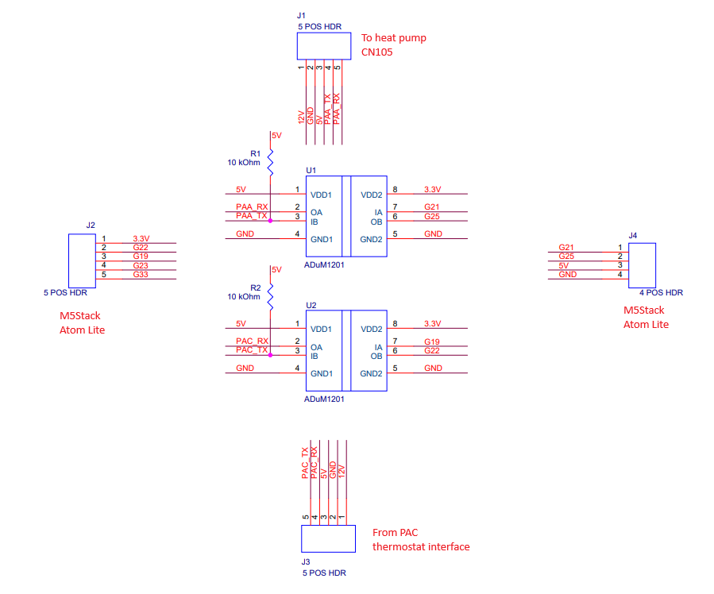
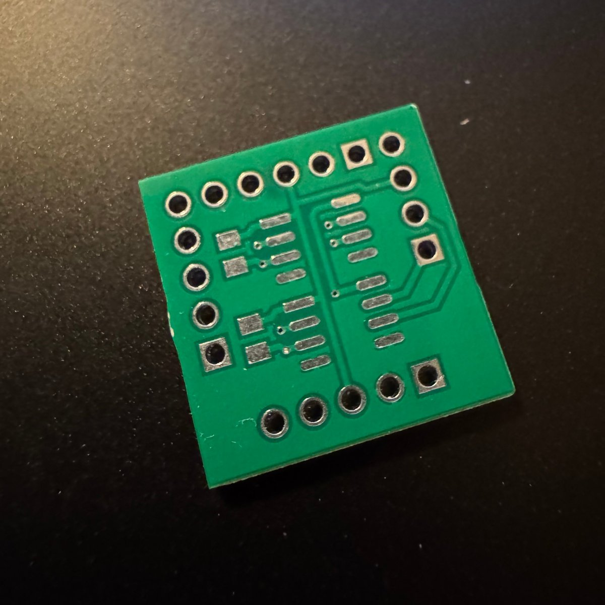
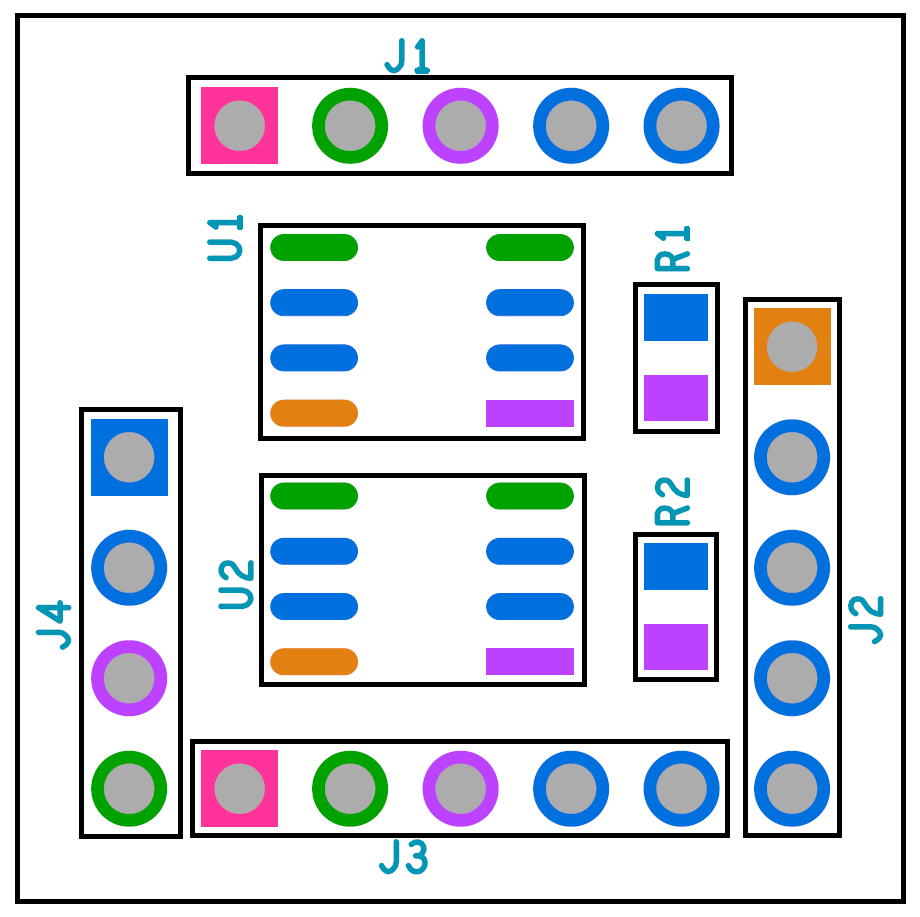
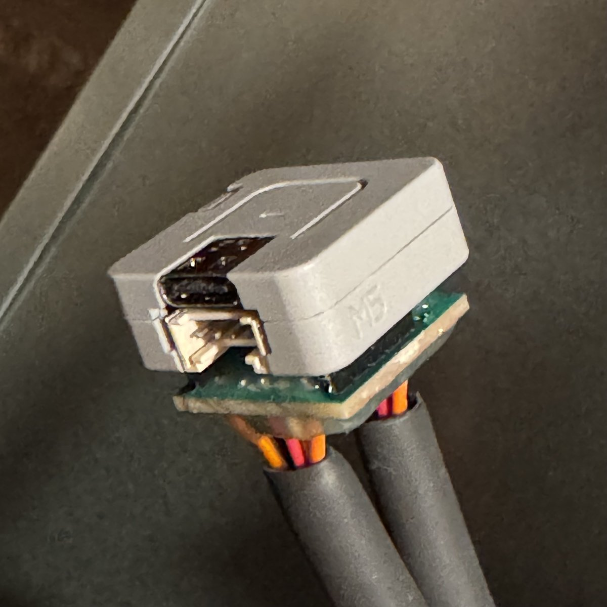
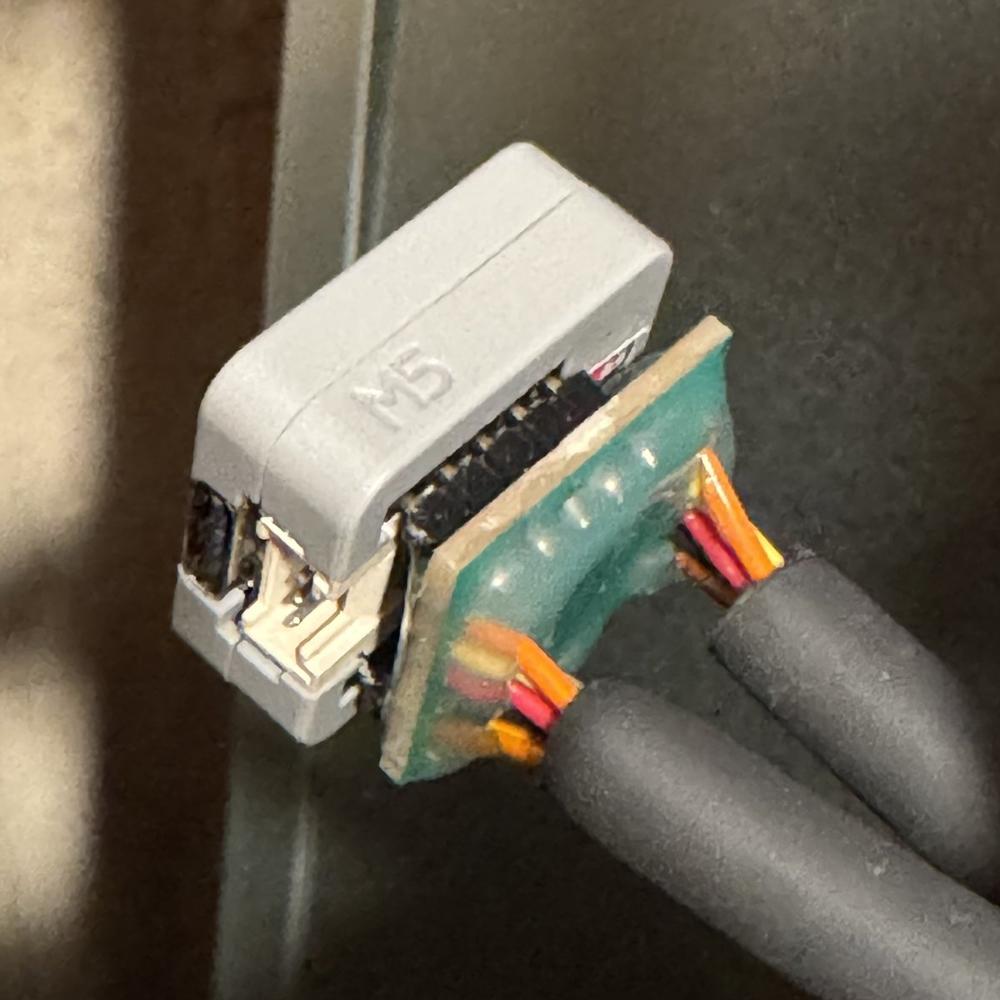

# PAC passthrough hardware: Atom Lite interposer board

This guide shows how to build the hardware for [PAC passthrough](pac-passthrough.md) around an **M5Stack Atom Lite**. The Atom Lite carries the firmware. A small custom interposer board plugs into the back of the Atom Lite and gives it the two level-shifted CN105 serial ports that PAC passthrough needs: one to the heat pump and one to the existing upstream controller.

- [What you are building](#what-you-are-building)
- [Parts list](#parts-list)
- [Building without PAC passthrough](#building-without-pac-passthrough)
- [The PCB](#the-pcb)
- [Circuit description](#circuit-description)
- [Assembly](#assembly)
- [Testing before installation](#testing-before-installation)
- [ESPHome configuration](#esphome-configuration)
- [Installation](#installation)
- [Troubleshooting](#troubleshooting)
- [Limitations and design notes](#limitations-and-design-notes)
- [Disclaimer](#disclaimer)

> [!CAUTION]
> Use at your own risk. This board carries the heat pump's 12 V and 5 V supply rails and connects directly to the CN105 port. Double-check every wire against the tables below before you power it from a real heat pump. A wiring mistake can damage the heat pump's control board, the Atom Lite, or the upstream controller. No guarantee is provided. See the [Disclaimer](#disclaimer).

> [!NOTE]
> In this guide, **PAA** is the heat pump (indoor unit) side of the board and **PAC** is the upstream controller side. These are the same names used in the schematic and in [PAC passthrough](pac-passthrough.md).

## What you are building

```
                    ┌───────────────────────────────────────────┐
                    │   Interposer PCB (plugs into Atom Lite)   │
  Upstream          │                                           │
  controller  ◄────►│ J3◄──►U2◄──►G19/G22 ┐                     │
  CN105 plug        │                     │                     │
  (PAC)             │                 Atom Lite                 │       Heat pump
                    │                     │                     │       indoor unit
                    │                     └ G21/G25◄──►U1◄──►J1 │◄────► CN105 header
                    │                                           │       (PAA)       
                    │   12 V, 5 V and GND pass straight         │
                    │   through from J1 to J3                   │
                    └───────────────────────────────────────────┘
```

The board does three things:

1. **Level shifts both serial ports.** CN105 is 5 V logic and the ESP32 is 3.3 V. Two ADuM1201 dual-channel digital couplers (one per port) translate each direction.
2. **Passes power through.** The heat pump's 12 V, 5 V and GND are connected between the heat pump connector (J1) and the controller connector (J3), so the upstream controller is powered exactly as if it were plugged into the heat pump directly.
3. **Powers the Atom Lite.** The Atom Lite takes its 5 V from the same CN105 5 V pin, so no separate supply is needed once installed.

| Feature | Value |
| --- | --- |
| Board | 2 layers, about 19.8 mm × 19.8 mm (0.78 in square) |
| Host | M5Stack Atom Lite (ESP32 classic) |
| Heat pump UART (`HP_UART`) | TX `GPIO21`, RX `GPIO25` |
| Controller UART (`PAC_UART`) | TX `GPIO19`, RX `GPIO22` |
| SMD parts | 2 × SOIC-8, 2 × 0603 |
| Through-hole parts | One 1×5 and one 1×4 header, plus 10 wires soldered into J1 and J3 |



## Parts list

All parts are available from DigiKey. The original cart is included as [pac-interposer-digikey-bom.xlsx](pac-passthrough-hardware-atom-lite/pac-interposer-digikey-bom.xlsx).

| Qty | Ref | Part | DigiKey part number | Manufacturer part number | Notes |
| --- | --- | --- | --- | --- | --- |
| 2 | U1, U2 | Digital isolator, 2 channel, 8-SOIC | 505-ADUM1201BRZ-ND | ADUM1201BRZ | Narrow-body SOIC-8 |
| 2 | R1, R2 | Resistor, 10 kΩ, 1 %, 0603 | 541-10.0KHCT-ND | CRCW060310K0FKEA | Any 10 kΩ 0603 works |
| 1 | J2 | Male header, vertical, 1×5, 2.54 mm | 2057-PH1-05-UA-ND | PH1-05-UA | Plugs into the Atom Lite |
| 1 | J4 | Male header, vertical, 1×4, 2.54 mm | 2057-PH1-04-UA-ND | PH1-04-UA | Plugs into the Atom Lite. Was on backorder when the cart was exported, so cut a 1×4 from any longer strip if needed |
| 1 | J1 | JST PAP-05V-S housing, 5 position, 2.00 mm | 455-1489-ND | PAP-05V-S | Mates with the heat pump CN105 header |
| 1 | J3 | JST PALR-05VF housing, 5 position, 2.00 mm | 455-1551-ND | PALR-05VF | Mates with the upstream controller's CN105 plug |
| 5 | J1, J3 | Pre-crimped cable, 8 in, SPAL contact on one end and SPHD contact on the other | 455-3336-ND | APALPA22K203 | Cut in half to make the 10 pigtails (see [Prepare the pigtails](#3-prepare-the-pigtails)) |
| 1 | n/a | M5Stack Atom Lite | 2221-C008-ND | C008 | The ESP32 host |

At the prices in the exported cart the parts total about **USD 22**, plus the PCBs.

Not in the cart, but needed:

- Heat-shrink tubing for strain relief (the reference build uses thick black tubing over each bundle of wires)
- Solder, flux, and a fine-tipped soldering iron (hot air is optional)
- A multimeter
- A small flush cutter, wire strippers and tweezers

> [!NOTE]
> The JST contacts are different on the two housings. The **SPHD** socket contacts go into the **PAP-05V-S** (J1, heat pump side). The **SPAL** pin contacts go into the **PALR-05VF** (J3, controller side). This is why each cable has a different contact on each end.

## Building without PAC passthrough

The interposer board is also useful on its own, **without** the PAC passthrough option. If you only want to connect an Atom Lite to the heat pump and have no upstream controller to keep in the loop, you can build the board without the controller-side circuit. That reduces the cost and the amount of soldering.

Leave out these parts:

| Ref | Part | Why it can be omitted |
| --- | --- | --- |
| U2 | ADUM1201BRZ | Level shifter for the controller UART only |
| R2 | 10 kΩ resistor | Pull-up on the controller's transmit line only |
| J3 | PALR-05VF housing and the five SPAL pigtails | Controller connector only |

Keep everything else: U1, R1, the J1 pigtails and **both** Atom Lite headers. J2 is still required because its 3.3 V pin supplies the low-voltage side of U1. The five SPAL pigtails from the cut cables are simply spare.

What changes in the instructions:

- **Assembly:** skip U2 and R2 in [step 1](#1-solder-the-resistors-r1-and-r2) and [step 2](#2-solder-the-adum1201-chips-u1-and-u2), skip J3 in [step 4](#4-solder-the-pigtails-into-j1-and-j3), and skip the PALR-05VF housing in [step 5](#5-insert-the-contacts-into-the-housings).
- **12 V wire:** the Atom Lite does not use 12 V, so the wire for J1 pin 1 can be left out. Only pins 2 to 5 (GND, 5V, PAA_TX and PAA_RX) need wires. Leave the matching position in the PAP-05V-S housing empty.
- **Testing:** skip the J3 rows in the [continuity table](#continuity-and-shorts). You still need J1 pin 2 to J4 pin 4 (GND) and J1 pin 3 to J4 pin 3 (5V), and no shorts between 5V, GND and 3.3 V.
- **ESPHome:** declare only `HP_UART` (`GPIO21` and `GPIO25`) and leave out `PAC_UART`, `uart_pac` and the other PAC options. `GPIO19` and `GPIO22` are then unused.
- **Installation:** plug J1 into the heat pump's CN105 header and nothing else. With no controller connected, the Atom Lite is the only load on the 5 V pin.

The same PCB is used either way. If you build it without the controller side and later want passthrough, you can add U2, R2 and J3 afterwards, because the footprints are on the board.

## The PCB

The Gerber and drill files are in [pac-interposer-gerbers.zip](pac-passthrough-hardware-atom-lite/pac-interposer-gerbers.zip). The files were generated by Cadence Allegro, so they use the `.art` and `.drl` extensions. If your PCB manufacturer's uploader does not detect the layers automatically, assign them with this table.

| File | Layer |
| --- | --- |
| `CN105-01.art` | Top copper |
| `CN105-02.art` | Bottom copper |
| `CN105-SMT.art` | Top solder mask |
| `CN105-SMB.art` | Bottom solder mask |
| `CN105-ART.art` | Top silkscreen and board outline |
| `CN105-FAB.art` | Fabrication drawing (reference only) |
| `CN105-1-2.drl` | Drill file (plated, top to bottom) |
| `nc_param.txt`, `nc_tools_auto.txt`, `art_param.txt` | Allegro output parameters (reference only) |

Fabrication notes:

- Two layers. Both layers have a ground pour. The set does not specify board thickness or surface finish, so order the manufacturer's standard 2-layer, 1.6 mm board.
- The drill file has 19 plated holes of 1.15 mm (45.3 mil) for the four headers and 7 plated vias of 0.2 mm (8 mil).
- There is **no solder paste layer** in the set. The board is designed to be hand soldered. If you want a stencil, generate one from the top solder mask file.

> [!TIP]
> [JLCPCB](https://jlcpcb.com) is a good, quick and inexpensive place to buy the bare PCBs. They also offer PCB assembly, so you can have U1, U2, R1 and R2 placed for you and skip the hardest soldering. Assembly needs a BOM and a pick-and-place (component position) file, which are not included in the Gerber set, and the parts would come from JLCPCB's own catalogue instead of the DigiKey cart above. You would still solder the headers and the J1 and J3 wires yourself.



## Circuit description

### Connectors

All four connectors use a 1-based pin numbering from the square pad. The assembly drawing below shows where each one is. Pin 1 of each connector is the square pad.



**J1: to the heat pump (CN105)**

| Pin | Net | Notes |
| --- | --- | --- |
| 1 | 12V | Tied to J3 pin 1 |
| 2 | GND | Common ground |
| 3 | 5V | Tied to J3 pin 3. Also powers the Atom Lite and both ADuM1201 chips |
| 4 | PAA_TX | Data **from** the heat pump. Pulled up to 5 V by R1 |
| 5 | PAA_RX | Data **to** the heat pump |

**J3: from the upstream controller (PAC)**

| Pin | Net | Notes |
| --- | --- | --- |
| 1 | 12V | Tied to J1 pin 1 |
| 2 | GND | Common ground |
| 3 | 5V | Tied to J1 pin 3 |
| 4 | PAC_RX | Data **to** the controller, on the line a real heat pump drives. Driven by the Atom Lite |
| 5 | PAC_TX | Data **from** the controller. Pulled up to 5 V by R2 |

J3 uses the same pin numbers as the CN105 header on the heat pump, so pin *n* on J3 is the same signal as pin *n* on the heat pump. The schematic draws J3 upside down, which is why its pins appear in the reverse order there. The board is built to the numbering in the tables above.

**J2: Atom Lite, 5-pin side header**

| Pin | Net | Used |
| --- | --- | --- |
| 1 | 3.3 V | Yes. Powers the low-voltage side of both ADuM1201 chips |
| 2 | G22 | Yes. `PAC_UART` RX |
| 3 | G19 | Yes. `PAC_UART` TX |
| 4 | G23 | No. The pad is not connected |
| 5 | G33 | No. The pad is not connected |

**J4: Atom Lite, 4-pin bottom header**

| Pin | Net | Used |
| --- | --- | --- |
| 1 | G21 | Yes. `HP_UART` TX |
| 2 | G25 | Yes. `HP_UART` RX |
| 3 | 5V | Yes. Powers the Atom Lite from CN105 |
| 4 | GND | Yes |

### Signal path

Each ADuM1201 has two channels that run in opposite directions, which is exactly what a UART needs.

| Direction | Path | Atom Lite pin |
| --- | --- | --- |
| Atom Lite to heat pump | G21 → U1 (IA → OA) → PAA_RX → J1 pin 5 | `HP_UART` TX, `GPIO21` |
| Heat pump to Atom Lite | J1 pin 4 → PAA_TX → U1 (IB → OB) → G25 | `HP_UART` RX, `GPIO25` |
| Atom Lite to controller | G19 → U2 (IA → OA) → PAC_RX → J3 pin 4 | `PAC_UART` TX, `GPIO19` |
| Controller to Atom Lite | J3 pin 5 → PAC_TX → U2 (IB → OB) → G22 | `PAC_UART` RX, `GPIO22` |

From the controller's point of view, the Atom Lite looks like a heat pump. That is why the Atom Lite transmits on the controller connector's pin 4 (the pin the heat pump normally drives) and receives on pin 5.

> [!NOTE]
> Both ADuM1201 chips are used only as level shifters. The grounds on both sides of each chip are connected, so the board does **not** give galvanic isolation between the heat pump and the Atom Lite.

## Assembly





In the finished build the interposer sits flat against the back of the Atom Lite, with the two wire bundles leaving the board's bottom face. The components (U1, U2, R1, R2) are on the top face, which faces the Atom Lite. The headers J2 and J4 have their plastic bodies on the top face, and their short pins are soldered on the bottom face.

### 1. Solder the resistors (R1 and R2)

1. Tin one pad of each 0603 footprint.
2. Place the resistor with tweezers, reflow the tinned pad, then solder the other end.
3. R1 is next to U1 and R2 is next to U2. Both are 10 kΩ and are not polarised.

### 2. Solder the ADuM1201 chips (U1 and U2)

Orientation matters. In the assembly drawing (J1 at the top), pin 1 of each chip is the **lower-right pad of its footprint**, which is the only pad with a rectangular outline. That pad is the chip's 5 V supply (VDD1). Put the pin 1 dot on the package at that corner.

| Footprint corner (assembly drawing orientation) | ADuM1201 pin | Signal |
| --- | --- | --- |
| Lower right (rectangular pad) | 1 | VDD1, 5 V |
| Right, second from the bottom | 2 | Output A |
| Right, third from the bottom | 3 | Input B |
| Upper right | 4 | GND1 |
| Upper left | 5 | GND2 |
| Left, second from the top | 6 | Output B |
| Left, third from the top | 7 | Input A |
| Lower left | 8 | VDD2, 3.3 V |

1. Tack one corner pin, check the alignment, then solder the opposite corner.
2. Drag-solder the remaining pins with flux, and remove any bridges with solder wick.
3. Inspect all 16 pins under magnification.

### 3. Prepare the pigtails

Each of the five cables has an **SPAL** (pin) contact on one end and an **SPHD** (socket) contact on the other. Cut each cable roughly in the middle. That gives:

- 5 pigtails with an **SPHD** contact. These go to **J1** and the **PAP-05V-S** housing.
- 5 pigtails with an **SPAL** contact. These go to **J3** and the **PALR-05VF** housing.

If the controller is further from the board than the heat pump (or the other way around), cut the cables off-centre so each side has the length it needs.

Strip about 2 mm from each cut end and tin the strands.

> [!TIP]
> Decide on a colour for each CN105 pin before you start and write it down. Because both the J1 and J3 bundles have five wires, a consistent colour code (the same colour for the same function on both) makes the connections much easier to check.

### 4. Solder the pigtails into J1 and J3

Solder the wires into the five holes of J1 and the five holes of J3 as given in the [connector tables](#connectors). Pin 1 is the square pad on each connector.

1. Work from the bottom face of the board, so the wires lie flat against the bottom and away from the Atom Lite.
2. Keep the top face flat. Trim any wire ends and solder fillets that stand proud on the top face, because the Atom Lite sits over it.
3. Make sure no strands bridge to the neighbouring pads. The pads are on a 2.54 mm pitch with a ground pour all around them.
4. Check each wire's other end: it must be the contact type for that connector (SPHD for J1, SPAL for J3).

### 5. Insert the contacts into the housings

Do this **after** the wires are soldered, and check the pin order twice.

1. Push each SPHD socket contact into the **PAP-05V-S** housing until it clicks. The circuit order must match J1: wire from J1 pin *n* goes into housing position *n*.
2. Push each SPAL pin contact into the **PALR-05VF** housing until it clicks. The circuit order must match J3: wire from J3 pin *n* goes into housing position *n*.
3. Give each wire a gentle tug to confirm the contact is locked.

The housings are polarised. Position 1 on each housing is the same position as pin 1 on the connector that it mates with, so the order is preserved when they are plugged together.

### 6. Solder the Atom Lite headers (J2 and J4)

1. Fit the 1×5 header into J2 and the 1×4 header into J4. Insert them from the **top** face with the plastic bodies against the board and the long pins pointing up, away from the board.
2. Solder the short pins on the bottom face.
3. Check that the pins are straight and perpendicular, because they have to plug into the Atom Lite's sockets.

### 7. Add strain relief

Slide heat-shrink over each wire bundle close to the board and shrink it. The reference build uses a thick sleeve over each bundle (see the photos above).

## Testing before installation

Do these checks with the **heat pump disconnected and the Atom Lite unplugged from the board**.

### Continuity and shorts

With a multimeter, confirm:

| Test | Expected |
| --- | --- |
| J1 pin 1 to J3 pin 1 (12V) | Continuity |
| J1 pin 2 to J3 pin 2 to J4 pin 4 (GND) | Continuity |
| J1 pin 3 to J3 pin 3 to J4 pin 3 (5V) | Continuity |
| 12V to GND | **No** continuity |
| 5V to GND | **No** continuity |
| 5V to 12V | **No** continuity |
| J2 pin 1 (3.3 V) to GND | **No** continuity |
| J1 pin 4 or 5 to J3 pin 4 or 5 | **No** continuity (the signal paths are separated by the chips) |

### Atom Lite orientation check

Before you plug the Atom Lite on, look at the labels printed on the back of the Atom Lite. The 4-pin socket (`G21`, `G25`, `5V`, `GND`) must line up with **J4**, and the 5-pin socket (`3V3`, `G22`, `G19`, `G23`, `G33`) must line up with **J2**. Never plug the board in rotated or offset by one pin. The 5 V rail is next to the signal pins.

### Flash the firmware first

Flash the Atom Lite with the firmware **before** you connect it to the heat pump:

1. Plug the interposer onto the Atom Lite.
2. Leave J1 and J3 unconnected.
3. Connect the Atom Lite to your computer over USB and flash the firmware.
4. Unplug USB.

After that, you can do updates over the air.

> [!WARNING]
> Do not connect USB while the board is powered from the heat pump. The Atom Lite's 5 V pin is wired to the CN105 5 V pin, so USB and the heat pump would be powering the same rail at the same time. Updates should use OTA once the board is installed.

## ESPHome configuration

The wiring in the table below is built into the PCB, so these are the pins to use:

| UART | Connected to | TX | RX |
| --- | --- | --- | --- |
| `HP_UART` | Heat pump (J1) | `GPIO21` | `GPIO25` |
| `PAC_UART` | Upstream controller (J3) | `GPIO19` | `GPIO22` |

A starting configuration, which you can combine with the options described in [PAC passthrough](pac-passthrough.md#configuration):

```yaml
esphome:
  name: heatpump-atom
  friendly_name: Heat Pump

esp32:
  board: m5stack-atom
  framework:
    type: esp-idf

external_components:
  - source: github://echavet/MitsubishiCN105ESPHome

logger:
  level: INFO

uart:
  - id: HP_UART
    baud_rate: 2400
    tx_pin: GPIO21
    rx_pin: GPIO25
  - id: PAC_UART
    baud_rate: 2400
    tx_pin: GPIO19
    rx_pin: GPIO22

climate:
  - platform: cn105
    id: hp
    name: Heat Pump
    uart_id: HP_UART
    uart_pac: PAC_UART
    pac_passthrough_timeout: 60s
    pac_passthrough_switch:
      name: PAC Passthrough
    pac_passthrough_sensor:
      name: PAC Passthrough Active
```

Notes:

- None of the four pins is on the Atom Lite's UART0 (`GPIO1`/`GPIO3`), so the default `logger` settings are fine. You do **not** need `hardware_uart` on the logger.
- Add the `api`, `ota`, `wifi` and Home Assistant heartbeat sections as in the [complete example](pac-passthrough.md#complete-example). They are the same for this board.
- The two UARTs use different pins, so the configuration validation in [PAC passthrough](pac-passthrough.md#validation-rules) is satisfied.

## Installation

1. Turn off power to the heat pump at the breaker before you plug or unplug anything.
2. Unplug the upstream controller's CN105 plug from the heat pump.
3. Plug the **PAP-05V-S** housing (J1) into the heat pump's CN105 header.
4. Plug the controller's CN105 plug into the **PALR-05VF** housing (J3).
5. Tuck the board and wires away so nothing is under tension, and keep the 12 V pin 1 conductors from touching anything.
6. Restore power. The Atom Lite should start and show up on your network. The controller should keep working as it did before.
7. Check the passthrough sensor and switch in Home Assistant, then test passthrough by turning the **PAC Passthrough** switch on.

> [!IMPORTANT]
> The upstream controller is powered **through** this board. Everything the controller used to draw from the heat pump now passes through the interposer's traces and your soldered wires, along with the Atom Lite's own supply. Check the resulting 5 V load, particularly on units where the CN105 5 V pin can only supply limited current (see the note in the [main README](../README.md#step-1-building-the-control-circuit)).

## Troubleshooting

| Symptom | Likely cause |
| --- | --- |
| Atom Lite does not power up | Check J1 pin 3 (5V) and pin 2 (GND) continuity to J4. Check the wires are in the correct positions in the PAP-05V-S housing |
| Atom Lite boots, no heat pump connection | RX and TX swapped on J1, a bad ADuM1201 soldering joint on U1, or R1 missing. Check the logs for the connection messages |
| Controller does not connect (normal mode) | Pins 4 and 5 of the PALR-05VF housing swapped, or a bad joint on U2. Check R2 |
| Controller shows no data | Check that the ESP is polling (`PAC_READ`/`PAC_WRITE` debug logs). See the [troubleshooting table](pac-passthrough.md#logging-and-troubleshooting) |
| Random resets or Wi-Fi drops after the controller is added | 5 V rail overloaded. See the note in [Installation](#installation) |
| Heat pump or controller behaves oddly after installation | Unplug everything, repeat the [continuity and shorts](#continuity-and-shorts) tests, and look for solder bridges on the U1 and U2 pins |

## Limitations and design notes

- **The board is a level shifter, not an isolator.** The two ground pins of each ADuM1201 are connected.
- **Power passes through, not around.** The board does not regulate or protect the 12 V and 5 V rails in any way, and has no fuse. The upstream controller and the Atom Lite share the heat pump's supply.
- **Ports are not interchangeable.** J1 must go to the heat pump and J3 to the upstream controller. The pull-ups (R1 and R2) are on the lines that the heat pump and controller transmit on.
- **`G23` and `G33` are free.** They are brought to the J2 pads for mechanical fit only and are not connected on the board, so they cannot be used from this board.
- **ESP32 classic only.** The pin assignments here are specific to the Atom Lite. A different host board needs a different interposer.

## Disclaimer

This design, the files and this guide are provided "as is", without warranty or guarantee of any kind, express or implied. Use them at your own risk. The authors and contributors accept no responsibility for any damage to the heat pump, the upstream controller, the Atom Lite, your home, or anything else, or for any injury, loss of warranty, or other consequence of building or using this board. The design has not been certified or tested to any electrical safety standard. Working on a heat pump may void its warranty and should only be done by someone competent to do it, with the power off.

This project is not affiliated with, endorsed by, or associated with Mitsubishi Electric Corporation or M5Stack. All product names are used for identification purposes only, to indicate compatibility.