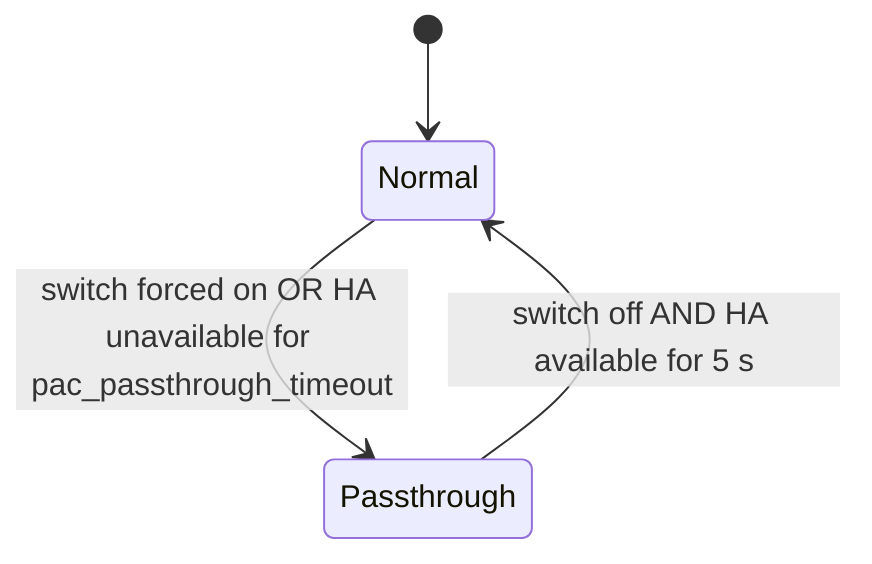

# PAC passthrough (dual UART)

The ESP can sit **between the heat pump and an existing CN105 controller** (for example a wired thermostat). Normally Home Assistant (through the ESP) controls the heat pump. If Home Assistant becomes unavailable, the ESP hands the bus to the original controller so the unit keeps working. When Home Assistant returns, the ESP takes control back and resynchronises.

> [!NOTE]
> In the code and in the YAML option names, **PAC** is the second UART and the **upstream controller** connected to it. The *heat pump* is on the normal `uart_id`.

- [How it works](#how-it-works)
- [Hardware](#hardware)
- [Configuration](#configuration)
- [Complete example](#complete-example)
- [Behavior in detail](#behavior-in-detail)
- [Entities](#entities)
- [Logging and troubleshooting](#logging-and-troubleshooting)
- [Limitations](#limitations)
- [Implementation notes](#implementation-notes)

## How it works

```
                 ┌──────────────────────────┐
 Upstream        │          ESP32           │        Heat pump
 controller ◄───►│ PAC_UART        HP_UART  │◄───►    (indoor unit)
 (CN105 master)  │                          │         CN105
                 └──────────────────────────┘
```

The ESP always owns the heat pump session. It runs in one of two modes:

| | Normal mode | Passthrough mode |
| --- | --- | --- |
| Who controls the heat pump | Home Assistant, through the ESP | The upstream controller |
| ESP polls the heat pump | Yes | No |
| Upstream controller sees | A virtual heat pump answered from the ESP's cache | The real heat pump, relayed frame by frame |
| Upstream SET commands | Acknowledged but **ignored** | Forwarded to the heat pump |
| Commands from Home Assistant | Applied | Ignored |
| Remote temperature from Home Assistant | Sent to the heat pump | Still sent, and takes priority over the controller's own (see [Remote temperature](#remote-temperature)) |
| Home Assistant entities | Updated | Updated from the heat pump’s replies to the controller’s requests |



## Hardware

The PAC UART is a second, independent CN105 serial port. Wire it the same way as the heat pump side:

- CN105 is 5 V logic and ESP32 pins are 3.3 V, so the PAC side needs its own level shifter channels.
- TX and RX must be crossed: ESP TX goes to the controller's RX, and ESP RX goes to the controller's TX.
- The two UARTs must use **different pins**. Configuration validation rejects shared pins.
- Both UARTs must be configured with `baud_rate: 2400`. The component sets 8 data bits, even parity and 1 stop bit on both ports automatically.

> [!IMPORTANT]
> This feature only changes the *data* path. Check the power arrangement for your controller and heat pump yourself; nothing in the firmware affects it.

The feature is **ESP32 only**. ESP8266 configurations fail validation if `uart_pac` is set.

> [!TIP]
> For a ready-made build with an M5Stack Atom Lite and a small interposer PCB, including Gerbers, a parts list and assembly steps, see [PAC passthrough hardware: Atom Lite interposer board](pac-passthrough-hardware-atom-lite.md).
> The same board can also be built without the controller side (U2, R2 and J3) for a lower-cost, single-port interface when you do not need passthrough.

## Configuration

All options live under the `cn105` climate platform. Everything except `uart_pac` is optional, and every other option **requires `uart_pac`**.

| Option | Type | Default | Description |
| --- | --- | --- | --- |
| `uart_pac` | UART id | none (feature off) | The UART connected to the upstream controller. Must differ from `uart_id` and must not share pins with it. |
| `pac_passthrough_timeout` | time | `60s` | How long Home Assistant must be unavailable before passthrough starts automatically. `never` disables automatic passthrough (the switch still works). |
| `ha_heartbeat_source` | text_sensor id | none | A `homeassistant` text sensor whose updates count as "Home Assistant is alive". See [Home Assistant availability](#home-assistant-availability). |
| `ha_heartbeat_timeout` | time | `2min` when a source is set | Maximum time between heartbeat updates. Requires `ha_heartbeat_source`. |
| `pac_passthrough_switch` | switch | none | Forces passthrough on. Optimistic and not restored on reboot. |
| `pac_passthrough_sensor` | binary_sensor | none | Reports whether passthrough is currently active. |

### Validation rules

| Error | Cause |
| --- | --- |
| `'<option>' requires 'uart_pac'` | One of the PAC options is set without `uart_pac`. |
| `'ha_heartbeat_timeout' requires 'ha_heartbeat_source'` | A timeout with nothing to time. |
| `'uart_pac' must reference a different UART than 'uart_id'` | Both options point at the same UART. |
| `'uart_pac' shares pin(s) [...] with 'uart_id'` | The two UARTs overlap on a TX or RX pin. |

## Complete example

### ESPHome

```yaml
uart:
  - id: HP_UART              # to the heat pump
    baud_rate: 2400
    tx_pin: GPIO21
    rx_pin: GPIO25
  - id: PAC_UART             # to the upstream controller
    baud_rate: 2400
    tx_pin: GPIO19
    rx_pin: GPIO22

# Receives a value from Home Assistant that changes on a fixed schedule.
text_sensor:
  - platform: homeassistant
    id: ha_heartbeat_source
    entity_id: sensor.esphome_heartbeat
    internal: true

climate:
  - platform: cn105
    id: hp
    name: Climate Control
    uart_id: HP_UART
    uart_pac: PAC_UART
    pac_passthrough_timeout: 60s
    ha_heartbeat_source: ha_heartbeat_source
    ha_heartbeat_timeout: 2min
    pac_passthrough_switch:
      name: PAC Passthrough
    pac_passthrough_sensor:
      name: PAC Passthrough Active
```

### Home Assistant heartbeat source

Home Assistant only pushes an entity's state to the ESP when it **changes**, so the heartbeat entity has to change on its own schedule. A trigger-based template sensor does that:

```yaml
# Home Assistant configuration.yaml
template:
  - trigger:
      - trigger: time_pattern
        seconds: "/30"
    sensor:
      - name: ESPHome heartbeat
        unique_id: esphome_heartbeat
        state: "{{ now().timestamp() | int }}"
```

If you would rather not write a template, any entity that ticks regularly works. The built-in Time & Date integration's `sensor.time` changes once a minute; in that case use `ha_heartbeat_timeout` of 3 minutes or more.

> [!WARNING]
> Do **not** use an ESP-side `template` text sensor as the source, and do not add filters or lambdas that re-publish or replace the value on a timer. Those make the ESP generate the very events the heartbeat is supposed to observe, so a dead Home Assistant would still look alive.

Choose `ha_heartbeat_timeout` as at least three times the entity's tick period, so one missed update does not flip the state.

## Behavior in detail

### Normal mode

The ESP polls the heat pump as usual. The upstream controller talks to a virtual heat pump:

| Controller sends | ESP does |
| --- | --- |
| `CONNECT` (`0x5A` or `0x5B`) | Replies `0x7A` or `0x7B` locally. Never forwarded. |
| Info request (`0x42`) | Replies with the last cached heat pump response for that request code, **if it is at most 30 s old**. Otherwise stays silent, so the controller never receives stale data. |
| SET (`0x41`) | Replies with an acknowledgement and **ignores the change**. The decoded fields are written to the log at DEBUG level. |
| Anything else | Ignored. |

Frames with a bad checksum, or with the wrong header bytes, are dropped.

The cache holds one slot of up to 32 bytes each for each of the eight polled codes; other codes are never cached. It is filled by the ESP's own polling, so only codes the ESP actually polls can be answered:

| Code | Content | Answerable when |
| --- | --- | --- |
| `0x02` | Settings | Always |
| `0x03` | Room temperature | Always |
| `0x04` | Error info | Always |
| `0x06` | Status | Always |
| `0x09` | Standby / sub-modes | Always |
| `0x42` | HVAC options | Only if an air purifier, night mode or circulator entity is configured |
| `0x20`, `0x22` | Function settings | Only if `hardware_settings` is configured, and only for 30 s after each read (default read interval is 24 h), so effectively not answered |

> [!NOTE]
> Changes made on the upstream controller in normal mode are **discarded**. The controller will read the previous values back from the cache and its display will revert. This is intentional: Home Assistant is the only controller until passthrough starts.

### Entering and leaving passthrough

The decision runs on every loop pass:

```
if switch_forced:                    passthrough
elif passthrough active:             stay until HA has been available for >= 5 s
else:                                enter when auto enabled AND HA unavailable for >= pac_passthrough_timeout
```

- **Automatic start:** `pac_passthrough_timeout` is measured from the moment Home Assistant became unavailable. If Home Assistant has never been available since boot, it is measured from boot.
- **Quiet moment:** the ESP only switches *into* passthrough when the heat pump is connected, no poll cycle is running, no HA-originated change is waiting to be sent, and nothing was written to the heat pump in the last 500 ms. If any of those is false, it waits and re-checks.
- **Return hold-off:** after Home Assistant comes back, passthrough continues for 5 more seconds. This stops a flapping connection from bouncing the bus between masters. Passthrough continues while HA is down.
- **Switch:** turning the switch **off** releases the forced state, and the automatic rules decide what happens next. If Home Assistant has been available for at least 5 s, passthrough ends immediately. If Home Assistant is unavailable, or only just returned, passthrough continues under the rules above.

Total time before a Home Assistant failure hands over the bus:

| Failure | Time to passthrough |
| --- | --- |
| API connection lost | Time for the API to notice the loss + `pac_passthrough_timeout` |
| Heartbeat stops (connection still up) | `ha_heartbeat_timeout` + `pac_passthrough_timeout` |

**On entry** the ESP discards queued Home Assistant changes and publishes the passthrough sensor. The remote temperature keep-alive keeps running (see [Remote temperature](#remote-temperature)).

**On exit** the ESP:

1. Discards anything queued during passthrough.
2. Clears its memory of the last user vane and temperature, so stale values are not re-sent in the next command.
3. Resets its view of the current settings, which forces a full resync on the next poll so Home Assistant sees whatever the controller changed.
4. Publishes the passthrough sensor.

### Passthrough mode

- **Relay:** every `SET` and info request from the controller is written unchanged to the heat pump, except temperature packets while a remote temperature is active (see [Remote temperature](#remote-temperature)). The heat pump's `0x61` (acknowledgement) and `0x62` (data) replies are written back to the controller.
- **One request at a time:** the ESP tracks one outstanding request. A reply is only relayed if it arrives within 2 s of the request, so controllers must not pipeline requests.
- **No polling:** the ESP stops its own poll cycle and does not apply Home Assistant commands. The one thing it still writes to the heat pump is the remote temperature (see [Remote temperature](#remote-temperature)).
- **`CONNECT` is still answered locally** and never forwarded. The privileges of the session are those of the ESP's own connection (see `installer_mode`), whatever the controller asked for.
- **Commands from Home Assistant** to the climate entity are ignored with a warning, and the entity state is republished so the UI snaps back. Changes made through other entities (vane selects, option switches, hardware settings) are queued but never sent, and are dropped on exit.
- **Entities update passively** during passthrough. Entities update passively as the controller polls, and that sensors for codes the controller never requests stay stale.

### Health check

While in passthrough the ESP watches the heat pump session:

- A forwarded request with no reply within 2 s counts as a failure.
- After 3 consecutive failures, or if the session is lost, the ESP reconnects to the heat pump (`Heat pump session lost during PAC passthrough, reconnecting...`).
- Reconnects are at least 15 s apart.
- Passthrough **stays active** during the reconnect. Controller frames are dropped until the heat pump answers the new `CONNECT`.

### Home Assistant availability

Home Assistant counts as **available** only when both of these are true:

1. **Transport:** `api::global_api_server->is_connected()` is true, meaning at least one API client is connected. If the API is not compiled in, `mqtt::global_mqtt_client->is_connected()` is used instead. If both are compiled in, only the API is checked.
2. **Heartbeat:** the last heartbeat is younger than `ha_heartbeat_timeout`. If no timeout is configured, this check always passes.

At boot the heartbeat is treated as fresh, so for roughly the first `ha_heartbeat_timeout` after boot only the transport check applies. After that, a heartbeat must have arrived.

### Remote temperature

Remote temperature works the same way in both modes. Values from Home Assistant are stored, the keep-alive repeats the last value, and `remote_temperature_timeout` clears it if Home Assistant stops updating it, which sends the heat pump back to its internal sensor. Passthrough does not pause any of this.

What passthrough changes is who else may talk to the heat pump, so the ESP keeps sending the remote temperature and gives it priority over the controller's:

| Situation | Temperature the heat pump uses |
| --- | --- |
| Normal mode, no remote temperature | The heat pump's internal sensor. The controller's temperature packets are acknowledged and ignored. |
| Normal mode, remote temperature active | The remote temperature. |
| Passthrough, remote temperature active | The remote temperature. The ESP keeps sending it and **acknowledges the controller's temperature packets without forwarding them**, so they cannot override it. |
| Passthrough, remote temperature timed out or never set | The controller's temperature if it sends one (its packets are forwarded as usual), otherwise the heat pump's internal sensor. |

- The remote temperature is **active** while the last value from Home Assistant is non-zero and has not timed out.
- New values are sent immediately. Otherwise the keep-alive resends the last value every `remote_temperature_keepalive_interval` (default 20 s). With the keep-alive set to `0s`, only new values from Home Assistant are sent, as in normal mode.
- When `remote_temperature_timeout` expires during passthrough, the ESP sends a single "revert to internal sensor" packet and cancels the timeout and the keep-alive. Nothing is re-armed until Home Assistant sends a new non-zero value. From that point the controller's temperature packets are forwarded again.
- A controller that never sends temperature packets is unaffected: the remote temperature simply keeps flowing.
- Nothing special happens when passthrough ends. The stored value, or zero if it timed out, is already current.
- Remote temperature packets are only sent when no controller request is waiting for a reply, so replies cannot be mixed up. A packet that has to wait is sent a moment later.

## Entities

| Entity | Option | Notes |
| --- | --- | --- |
| Switch | `pac_passthrough_switch` | On forces passthrough regardless of Home Assistant. Starts off at every boot. |
| Binary sensor | `pac_passthrough_sensor` | On while passthrough is active. Starts off. |

## Logging and troubleshooting

Set `logger: level: DEBUG` to see the decoded controller commands and packet dumps. Relevant tags:

| Tag | Content |
| --- | --- |
| `PAC` | State changes, decoded upstream SET commands, dropped frames |
| `PAC_READ` / `PAC_WRITE` | Raw frames to and from the controller (DEBUG builds only) |

Example of a decoded command in normal mode:

```
[D][PAC]: SET 0x01 from upstream ignored (HA in control): mode=HEAT temp=21.5C fan=AUTO
```

| Message or symptom | Meaning and fix |
| --- | --- |
| `Home Assistant is now unavailable` / `available` | Availability changed. The passthrough timer starts or resets here. |
| `Entering PAC passthrough` / `Leaving PAC passthrough` | Mode changes. |
| Controller never connects | Check TX/RX crossing, level shifting, baud rate (2400) and that the PAC pins are not shared with the heat pump UART. |
| `dropping invalid frame` | Bad checksum or wrong header, usually wiring noise or a wrong baud rate. |
| `no cached reply for 0x.., not answering` | The ESP has not polled that code (see the cache table). |
| `cache for 0x.. is stale, not answering` | The data is older than 30 s, for example during a long poll interval. |
| `dropping upstream frame: heat pump session is down` | The controller spoke during passthrough while the ESP had no heat pump session. |
| `No heat pump reply to forwarded request (n/3)` | The heat pump is not answering relayed requests. After 3 the ESP reconnects. |
| `Ignoring command: PAC passthrough is active` | Expected: Home Assistant cannot control the unit in passthrough. |
| `Upstream remote temperature ignored: ESP remote temperature .. is active` | Expected: a controller temperature packet was acknowledged but not forwarded because a remote temperature from Home Assistant is active. |
| `swallowing heat pump reply to ESP remote temperature packet` | Expected: the heat pump's acknowledgement of the ESP's own temperature packet was not relayed to the controller. |
| Never enters passthrough | Check the heat pump is connected, that a pending change is not blocking the quiet-moment check, and that `pac_passthrough_timeout` is not `never`. |
| Enters passthrough about a minute after boot | Home Assistant was not available. Check the API connection and the heartbeat entity. |
| Enters passthrough repeatedly | The heartbeat entity is not updating, or `ha_heartbeat_timeout` is shorter than three tick periods. |

## Limitations

- **Controller changes are ignored in normal mode.** The acknowledgement tells the controller its change succeeded, but it did not.
- **Not all info requests are answered** in normal mode (see the cache table).
- **Latency follows the controller’s poll rate** A controller SET is acked with no state, so HA learns the new value when the controller next reads 0x02. Most wall controllers poll every few seconds.
- **The transport check cannot tell Home Assistant from other API clients.** `is_connected()` is true for any connected API client, so a viewer that is only reading logs makes the API look connected. Configure a heartbeat source if you need to detect "connected but Home Assistant is not really there".
- **Controller temperatures are overridden, not merged.** While a remote temperature is active, the controller's own temperature packets are acknowledged and dropped. If the heat pump does not answer a remote temperature packet sent by the ESP, a controller acknowledgement arriving in the next 2 s can be swallowed instead of relayed. This is rare and heals itself on the next request.
- **The forced switch is not persisted.** It is off after every reboot.
- **A heartbeat source is only a freshness signal.** It proves Home Assistant is pushing state, not that your automations are working.
- **Baud rate and parity of `PAC_UART`** are not validated beyond what the component forces (8E1). Set `baud_rate: 2400` yourself.

## Implementation notes

| File | Role |
| --- | --- |
| `climate.py` | Options, validation, and PAC UART configuration |
| `pac_readings.cpp` | PAC frame handling, cache, passthrough state machine, health check |
| `cn105_protocol.h` | `build_frame()` and the heartbeat freshness predicate (unit tested) |
| `frame_parser.h` | Frame assembly, shared by the heat pump and PAC parsers |
| `pac_passthrough_switch.h` | The optimistic forced-passthrough switch |
| `hp_readings.cpp` | Routes heat pump `0x61` and `0x62` frames to the relay or the normal decoders |
| `hp_writings.cpp` | Builds the remote temperature packet; in passthrough it is written without the heat pump activity check |
| `climateControls.cpp` | Rejects climate commands while in passthrough |
| `componentEntries.cpp` | Drains the PAC UART and runs the state machine in `loop()` |